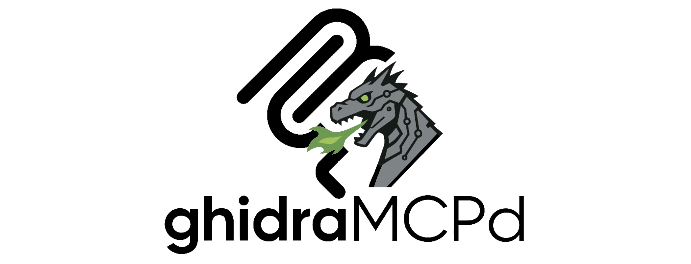

# GhidraMCPd

An MCP server that lets an AI assistant work in Ghidra -- search, read, disassemble,
decompile, and (when you allow it) rename and comment -- while spending as few tokens as
the question needs.

> **Text:** written by Claude, read and fact-checked by the maintainer.
> **Code:** mostly AI-generated (Codex, AiderDesk, Claude Code), tested by use, by the
> test suite and by live checks against a reference program, not reviewed line by line.
>
> Fork of [GhidraMCP](https://github.com/LaurieWired/GhidraMCP) by @LaurieWired.
> Apache 2.0.

## Why it exists

Reverse engineering firmware with a language model is a long conversation of small
questions: where is this string used, what is at this address, what does this function
touch. Every answer is paid for in tokens, and the original GhidraMCP answered generously
-- whole listings, every match, failures as prose. GhidraMCPd keeps the plugin idea and
puts a bridge in front of it that answers in fixed, compact shapes, batches what would be
several round trips, and says plainly when an answer is cut short or a request failed.

## How it fits together

```
MCP client (Claude Code, Claude Desktop, ...)
   |  MCP over stdio
Bridge (Python, this repo: bridge/)          -- tools, budgets, schemas, write guard
   |  HTTP, 127.0.0.1:8080
Ghidra plugin (Java, this repo: src/)        -- runs inside Ghidra, talks to its API
```

The plugin and the bridge are versioned together: the bridge accepts exactly one plugin
answer convention (API 3) and refuses any other, so update both from the same checkout.

## What it does

### Reading

35 tools ([catalogue](docs/reference/tools.md)). The ones a session spends most time with:
`search_functions`, `search_strings` and `string_xrefs_compact` to find things;
`analyze_function_complete` for a one-call dossier on a function; `disassemble_at`,
`find_in_function` and `read_words` to look closer; `collect` to batch several queries
into one round trip.

### Answers that say what they are

A failed request is an error, never an empty result. A list cut at its limit says
`truncated`. A listing that starts later than asked says where it starts. A missing
plugin, a wrong plugin version or a program that is still being analysed are named as
such, with what to do.

### Writing, if you allow it

Renames, comments, labels and structure edits are dry runs by default and need
`GHIDRA_MCP_ENABLE_WRITES=true` before anything reaches Ghidra. `list_mutations` shows
what a session changed since the last save; nothing is saved unless you call
`save_program`.

## Quickstart

You need Ghidra 11.4.2, a JDK (17 or newer) and Maven to build the plugin, and Python 3 for the bridge
(developed on 3.13).

```bash
git clone https://github.com/mad-sol-dev/GhidraMCPd.git
cd GhidraMCPd
python -m venv .venv
.venv/bin/pip install -r requirements.txt
GHIDRA_DIR=/path/to/ghidra_11.4.2_PUBLIC mvn -DskipTests -Drevision="$(scripts/plugin_version.sh)" package
```

Install `target/GhidraMCP-<version>.zip` in Ghidra (*File > Install Extensions*), restart
Ghidra, enable *GhidraMCP* (*File > Configure > Developer*), and open a program in the
CodeBrowser. `curl http://127.0.0.1:8080/plugin_version` should answer with `"api": 3`.

Then register the bridge with your client, for Claude Code:

```bash
claude mcp add ghidra -- /path/to/GhidraMCPd/.venv/bin/python /path/to/GhidraMCPd/scripts/bridge_stdio.py --transport stdio
```

and ask something small first ("which program is open in Ghidra?"). Claude Desktop, other
clients, settings and writes: [docs/setup.md](docs/setup.md).

## Documentation

- [Setup](docs/setup.md) -- building, installing, client configuration, settings.
- [Using the tools](docs/tools.md) -- which tool for which question, typical paths.
- [Design](docs/design.md) -- the answer conventions, the budgets, and how the rework went.
- [Troubleshooting](docs/troubleshooting.md) -- error codes and what to do about them.
- [Development](docs/development.md) -- tests, live checks, building, releasing.
- Reference: [tools](docs/reference/tools.md), [plugin HTTP API](docs/reference/plugin-api.md),
  [bridge HTTP API](docs/reference/http-api.md) (all generated).
